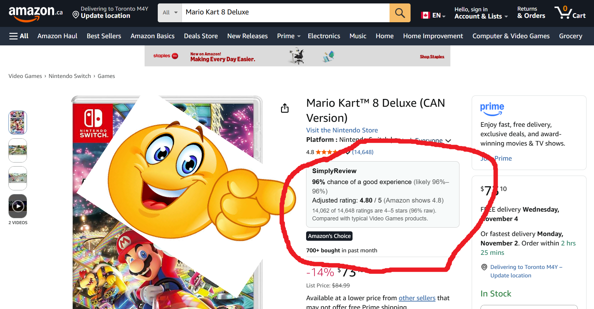

# SimplyReview

a chrome extension with a more honest rating 



some products are just slop and it sucks, even the ratings are botted. SimplyReview uses Bayes' theorem to adjust for how many reviews a product has, and shows how sure it is with a range like "likely 76–98%".

Inspired by 3Blue1Brown's [Binomial distributions | Probabilities of probabilities](https://www.youtube.com/watch?v=8idr1WZ1A7Q).

## How it works

1. Read the star breakdown on the Amazon page you're looking at.
2. Find the product's category from the page's category links.
3. Add a few "pretend reviews" that look like a typical product in that category.
4. Show the chance of a good experience (4–5 stars), with a 90% range, and an adjusted star rating.

## Results

for each product with 200+ reviews, i looked only at its first 10 reviews, predicted its long-run rating, and compared with what it really ended up being. the number of pretend reviews was tuned on half the products and checked on the other half.

| Category | Products | Pretend reviews | Less star error | Less good-experience error |
|---|---|---|---|---|
| Beauty | 247 | 10 | 29% | 34% |
| Appliances | 1,711 | 10 | 27% | 30% |
| Video Games | 4,137 | 20 | 29% | 32% |

compared with the raw star average, across **6,095 products**.

source data: [Amazon Reviews 2023](https://huggingface.co/datasets/McAuley-Lab/Amazon-Reviews-2023) (McAuley Lab).

## how to run the program

```powershell
python -m venv .venv
.venv\Scripts\pip install pandas huggingface_hub
.venv\Scripts\python notebooks\01_backtest.py
```

this downloads the reviews, prints the results, and saves the tuned numbers to `extension/prior.js`.

then load the extension: go to `chrome://extensions`, turn on dev mode, click **Load unpacked**, and choose the `extension` folder.
